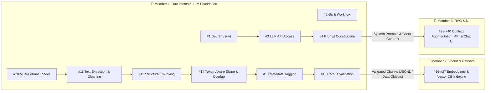
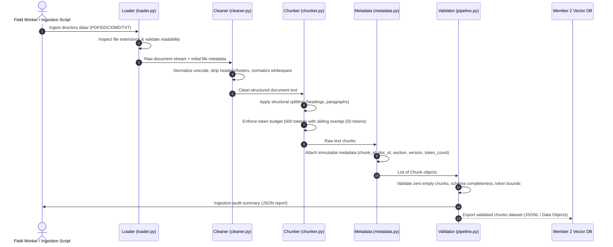
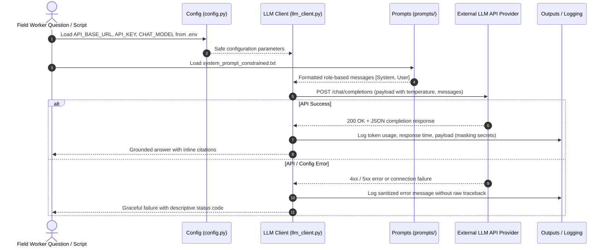
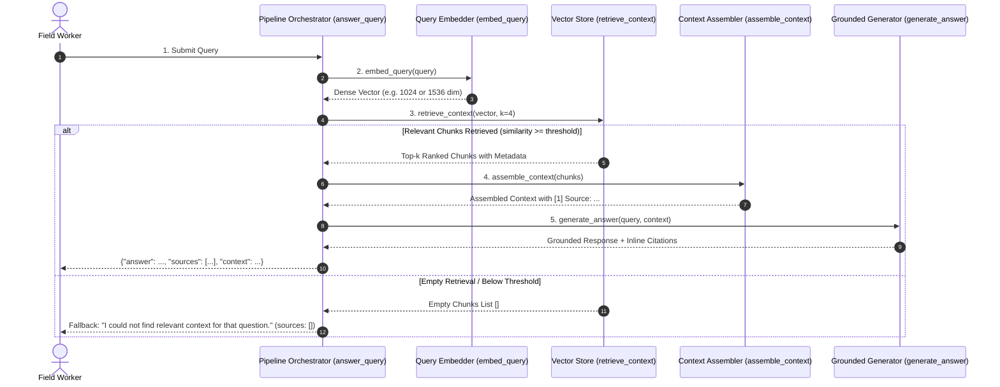

# FieldSure AI — System Architecture (Member 1 Scope)

> **Document Scope**: Architecture and design specifications for **Member 1 (Document Processing & LLM Foundation)**, detailing data flows, component boundaries, interfaces, and integration contracts with Member 2 (Embeddings & Retrieval) and Member 3 (RAG, Backend & Application).

---

## 1. System Overview & Module Responsibilities

Member 1 establishes the foundational data ingestion pipeline and LLM communication layer for FieldSure AI across 10 specific modules:



### Module Responsibilities Breakdown

| Module | Identifier | Core Responsibility |
| :--- | :--- | :--- |
| **#1** | `workspace_setup` | Configure `pyproject.toml`, `.env.example`, `.gitignore`, and `uv` virtual environment. |
| **#2** | `repo_workflow` | Scaffolding directory tree, standardizing imports, linting/formatting rules, and team workflow. |
| **#3** | `llm_client` | Safe credential loading (`.env`), LLM client initialization, error-handled chat completion (`src/chat_completion.py`). |
| **#4** | `prompt_engineering` | Role-based prompt engineering (`prompts/`), baseline vs. constrained comparative evaluation (`src/prompt_comparison.py`). |
| **#10** | `doc_loader` | Multi-format reader dispatching `.pdf`, `.docx`, `.md`, and `.txt` files from `data/` safely. |
| **#11** | `text_cleaner` | Text extraction, unicode normalization (NFKC), excessive whitespace collapsing, header/footer cleaning. |
| **#12** | `chunker` | Semantic boundary chunking (splitting on section headers, markdown headings, paragraph breaks). |
| **#13** | `metadata_tracker` | Traceability tagging (`doc_id`, `source_file`, `title`, `version`, `date`, `section`, `chunk_index`). |
| **#14** | `token_budget` | Token-aware size enforcement (e.g. 500 max tokens) and sliding window overlap calculation. |
| **#15** | `corpus_validator` | End-to-end ingestion runner, corpus health audit, empty chunk filtering, and JSONL export for Member 2. |

---

## 2. Workspace & Folder Structure

The project workspace strictly isolates concerns. Member 1 creates and manages the ingestion pipeline, prompts, outputs, and LLM utilities without stepping into downstream directories:

```
SW_S66_FieldSure_AI_Kalvium-Community/
│
├── data/                         # Public health documents (PDF, DOCX, MD, TXT) [git-ignored]
│   └── sample_advisories/        # Sample verified guidance documents for testing/validation
│
├── src/                          # Application source code
│   ├── __init__.py
│   ├── config.py                 # Centralized configuration & environment loader
│   ├── llm_client.py             # LLM API client wrapper with clean error handling
│   ├── chat_completion.py        # Module #3: Baseline completion entry point
│   ├── prompt_comparison.py      # Module #4: Comparative evaluation entry point
│   │
│   └── ingestion/                # Document processing pipeline (Modules #10-#15)
│       ├── __init__.py
│       ├── loader.py             # Module #10: Multi-format file intake
│       ├── cleaner.py            # Module #11: Text extraction & sanitization
│       ├── chunker.py            # Modules #12 & #14: Recursive & token-aware chunking
│       ├── metadata.py           # Module #13: Source & version metadata schema
│       └── pipeline.py           # Module #15: End-to-end ingestion & validation runner
│
├── prompts/                      # Prompt templates
│   ├── system_prompt_baseline.txt     # Baseline / unconstrained system prompt
│   └── system_prompt_constrained.txt  # Strict grounding & citation-enforced prompt
│
├── outputs/                      # Logs, execution artifacts, and sample outputs
│   ├── chat_completion_sample.log
│   ├── prompt_comparison_sample.log
│   └── ingestion_validation_report.json
│
├── tests/                        # Automated unit and integration tests
│   ├── test_llm_client.py
│   ├── test_loader.py
│   ├── test_cleaner.py
│   ├── test_chunker.py
│   └── test_ingestion_pipeline.py
│
├── .env.example                  # Environment secrets template
├── .gitignore                    # Git exclusion rules
├── pyproject.toml                # UV project configuration and dependency tree
├── uv.lock                       # Lockfile ensuring cross-platform reproducibility
├── Readme.md                     # Repository documentation
├── PRD.md                        # Product requirements document
├── ARCHITECTURE.md               # System architecture (this document)
├── DESIGN.md                     # Technical implementation decisions
├── RULES.md                      # Strict coding and architecture rules
├── TASKS.md                      # Module-by-module task tracking
├── MEMORY.md                     # Current state and project memory
└── AGENTS.md                     # AI agent operational guidelines
```

---

## 3. Data Flows & Processing Pipelines

### 3.1 Document Ingestion Flow (Modules #10–#15)



### 3.2 LLM Client & Prompt Flow (Modules #3 & #4)



### 3.3 End-to-End RAG Pipeline Architecture & Flow (Module #28)



---

## 4. Shared Interfaces & Data Contracts

To guarantee seamless handoffs across team members, Member 1 implements strict, typed data contracts:

### 4.1 Document & Chunk Data Contract (Handoff to Member 2)

```python
from dataclasses import dataclass, field
from typing import Optional, Dict, Any

@dataclass(frozen=True)
class DocumentMetadata:
    doc_id: str                      # Unique hash of file content or name
    source_file: str                 # Relative path, e.g., "data/covid19_protocol_v2.pdf"
    title: str                       # Extracted or inferred document title
    document_version: str            # Version string, e.g., "v2.1", "2024-R1"
    publication_date: Optional[str]  # ISO date string (YYYY-MM-DD) if available
    agency: Optional[str]            # Issuing body, e.g., "WHO", "CDC", "MOH"
    file_type: str                   # "pdf", "docx", "md", "txt"

@dataclass(frozen=True)
class ChunkMetadata:
    chunk_id: str                    # Unique hash: f"{doc_id}_c{chunk_index:04d}"
    doc_id: str                      # Parent document reference
    source_file: str                 # File name / path reference for citations
    document_title: str              # Title for citation display
    document_version: str            # Version for citation verification
    section_heading: Optional[str]   # Nearest enclosing section/header
    chunk_index: int                 # 0-indexed position within parent document
    total_chunks: int                # Total number of chunks in parent document
    char_length: int                 # Character count of chunk text
    token_count: int                 # Accurate token count from tokenizer
    extra_metadata: Dict[str, Any] = field(default_factory=dict)

@dataclass
class DocumentChunk:
    chunk_id: str
    text: str                        # Cleaned text content ready for embedding
    metadata: ChunkMetadata          # Comprehensive traceable metadata
```

### 4.2 LLM Completion Interface (Handoff to Member 3)

```python
from typing import List, Dict, Optional, Any
from dataclasses import dataclass

@dataclass(frozen=True)
class LLMMessage:
    role: str                        # "system", "user", "assistant"
    content: str                     # Prompt or response text

@dataclass(frozen=True)
class CompletionResult:
    content: str                     # Generated response text
    model: str                       # Model identifier used
    prompt_tokens: int               # Prompt token consumption
    completion_tokens: int           # Generated token consumption
    total_tokens: int                # Aggregate token count
    finish_reason: str               # "stop", "length", etc.
    raw_response: Optional[Dict[str, Any]] = None
```

---

## 5. Integration Boundaries with Other Members

### 5.1 Member 1 ➔ Member 2 (Embeddings & Vector Database)
- **Handoff Artifact**: A serialized JSONL file (`outputs/ingested_chunks.jsonl`) or a Python generator yielding validated `DocumentChunk` instances.
- **Member 2 Expectation**: Member 2 consumes `chunk.text` to generate vector embeddings, and persists `chunk.metadata` directly into their Vector Database (e.g., ChromaDB, Qdrant, FAISS) for metadata filtering.
- **Contract Stability**: Member 1 guarantees that `chunk_id` is unique and deterministic, `text` is non-empty, and `token_count` does not exceed the model's embedding context length.

### 5.2 Member 1 ➔ Member 3 (RAG, Backend API & Application)
- **Handoff Artifact**:
  - Reusable `llm_client.py` providing a clean completion method.
  - Standardized system prompt template (`prompts/system_prompt_constrained.txt`) defining grounding rules, citation format, and refusal phrases.
- **Member 3 Expectation**: Member 3 imports the LLM client and system prompt template into their RAG orchestration pipeline, injecting retrieved context from Member 2 into the user prompt.

---

## 6. Error Handling & Validation Architecture

1. **Document Loading Errors**:
   - Non-existent files or unsupported extensions raise descriptive `UnsupportedFileError` or `CorruptDocumentError` rather than crashing the batch run.
   - Faulty documents are recorded in an error ledger; valid documents in the batch continue processing.
2. **Text Cleaning & Extraction Errors**:
   - Zero-length text after extraction triggers an empty document warning and skips chunking.
   - Malformed unicode characters are replaced safely via `errors="replace"`.
3. **Token Limit Breaches**:
   - The chunker checks each piece against the token threshold. If a single sentence exceeds the token budget (e.g., in unbroken code or long scientific tables), it falls back to character slicing at whitespace boundaries with warning logs.
4. **LLM API & Network Failures**:
   - Missing `.env` or missing API keys trigger an explicit `ConfigurationError` explaining how to configure `.env` before attempting any network requests.
   - HTTP timeouts, 401 unauthorized, or 429 rate limit errors are caught and logged with actionable hints (e.g., *"Check API key or rate quota"*), returning non-zero exit codes without leaking secrets or printing raw tracebacks.
