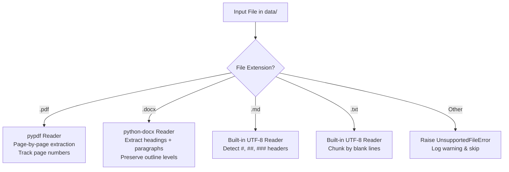
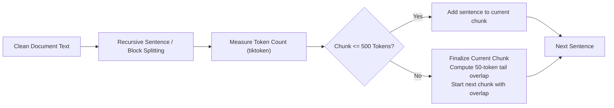

# FieldSure AI — Technical Design Document (DESIGN.md)

> **Document Scope**: Technical implementation decisions, algorithmic strategies, dependency rationale, metadata schema, and error-handling protocols for **Member 1 (Document Processing & LLM Foundation)**.

---

## 1. Proposed Python Libraries & Dependency Rationale

FieldSure AI strictly prioritizes the **Python standard library** for core logic (file I/O, regex, data structures, hashing, error handling) to minimize external attack surfaces and dependency churn. Third-party packages are selected only when standard-library equivalents do not exist or are insufficient.

| Library / Tool | Category | Proposed / Standard | Justification & Tradeoffs |
| :--- | :--- | :--- | :--- |
| **uv** | Dependency Manager | Tooling | Replaces `pip`, `venv`, and `pip-tools` with an extremely fast, Rust-based package resolver. Mandated by repository standard (`Readme.md`). |
| **pathlib** | File System | Standard Library | Built-in, cross-platform path handling for Windows, macOS, and Linux without platform path delimiter issues. |
| **dataclasses** | Data Modeling | Standard Library | Lightweight, zero-overhead strongly-typed data containers for document and chunk contracts. |
| **unicodedata** & **re** | Text Sanitization | Standard Library | Native unicode normalization (`NFKC`) and regular expression parsing without heavy NLP dependencies. |
| **pypdf** | PDF Extraction | Third-Party | Pure Python PDF extraction library. Avoids C/C++ compilation toolchains (e.g., Poppler or MuPDF binaries) required by `pdfplumber` or `fitz/PyMuPDF`, ensuring seamless installation across all OS environments. *(Decision requiring confirmation)* |
| **python-docx** | DOCX Extraction | Third-Party | Industry standard for inspecting `.docx` document trees, extracting paragraph styles, tables, and heading hierarchies natively. |
| **tiktoken** | Token Counting | Third-Party | Fast BPE tokenizer matching OpenAI / standard LLM subword token boundaries. Accurately counts tokens for context window budgeting. *(Decision requiring confirmation)* |
| **httpx** | HTTP & LLM Client | Third-Party | Modern, type-annotated HTTP client supporting synchronous and asynchronous requests with robust timeout management. Alternatively, official `openai` SDK can be used for standard endpoints. |
| **python-dotenv** | Configuration | Third-Party | Simple, zero-magic loading of `.env` files into `os.environ` during local development. |
| **pytest** | Testing | Dev Dependency | Industry-standard test runner with clean fixture injection, assertion reporting, and test discovery. |

---

## 2. File Formats & Text Extraction Approach

Public health guidelines and advisories arrive in heterogeneous formats. The document loader (`src/ingestion/loader.py`) dispatches files based on MIME/extension:



### 2.1 Extraction Protocols by Format

1. **PDF Files (`.pdf`)**:
   - Extracted iteratively page-by-page to prevent high memory spikes.
   - Text per page is tagged with `page_number` in raw metadata.
   - Headers and recurring running footers (e.g., *"Page X of Y"*, *"CONFIDENTIAL"*) are identified via frequency across pages and stripped.
2. **Word Documents (`.docx`)**:
   - Iterates through `doc.paragraphs`, preserving style metadata (e.g., `Heading 1`, `Heading 2`, `Normal`).
   - Prefix headings as markdown-style `#` headers to retain semantic structure for the downstream chunker.
   - Tables are extracted as markdown-formatted pipe tables where readable.
3. **Markdown (`.md`)**:
   - Read directly as UTF-8.
   - Preserves native `#` hierarchy, lists, and tables without modification.
4. **Plain Text (`.txt`)**:
   - Read with UTF-8 encoding (falling back to `latin-1` if decoding errors occur).

---

## 3. Text Cleaning Strategy

Raw extracted text contains formatting noise, control characters, and OCR/PDF artifacts that degrade retrieval and LLM context. The cleaner (`src/ingestion/cleaner.py`) applies a deterministic, non-destructive cleaning pipeline:

1. **Unicode Normalization**:
   - Transform text via `unicodedata.normalize("NFKC", text)` to standardize ligatures (e.g., `fi` ➔ `fi`), curly quotes, and non-standard whitespace.
2. **Control Character Stripping**:
   - Strip non-printable ASCII/Unicode control characters (`\x00`–`\x08`, `\x0b`, `\x0c`, `\x0e`–`\x1f`), while preserving standard newlines (`\n`) and tabs (`\t`).
3. **Whitespace Standardization**:
   - Collapse excessive horizontal spaces (`[^\S\r\n]+` ➔ single space).
   - Collapse three or more consecutive line breaks into two line breaks (`\n{3,}` ➔ `\n\n`) to preserve paragraph separation without inflating tokens.
4. **Header/Footer & Boilerplate Removal**:
   - Detect and remove repetitive document metadata lines (e.g., running headers, page numbers, trailing copyright footers).
5. **Content Integrity Assurance**:
   - Never remove numbers, punctuation, dosage terms, or clinical abbreviations (e.g., `mg/kg`, `COVID-19`, `v1.2`, `pH`).

---

## 4. Chunking Strategy

Standard naive fixed-character chunking splits sentences or clinical tables mid-thought, destroying retrieval accuracy. FieldSure AI implements a **Recursive Structural Chunker** (`src/ingestion/chunker.py`):

### 4.1 Split Hierarchy
Splits are attempted hierarchically in order of semantic significance:
1. Double line break with major heading: `\n\n# `, `\n\n## `, `\n\n### `
2. Paragraph breaks: `\n\n`
3. Single line breaks / list items: `\n- `, `\n* `, `\n1. `, `\n`
4. Sentence boundaries: `(?<=[.!?])\s+`
5. Word boundaries: ` `

### 4.2 Preservation of Section Context
When a chunk is split across a large section, the chunker prepends the current section heading (e.g., `[Section: Cold Chain Storage Guidelines]`) to the top of the chunk to maintain grounding and retrieval relevance.

---

## 5. Token Counting & Overlap Approach

To prevent context truncation in embedding models and LLM generation:



1. **Tokenizer**: `tiktoken` with `cl100k_base` encoding (compatible with OpenAI and modern open-weight embedding models).
2. **Chunk Size Budget**:
   - **Default Target**: **500 tokens** (optimal balance between granular semantic retrieval and contextual completeness).
   - **Configurable Range**: 256–800 tokens.
3. **Overlap Budget**:
   - **Default Overlap**: **50 tokens** (~10% overlap).
   - The chunker tracks the last tokens of Chunk $N$ and prepends them to Chunk $N+1$ to prevent boundary clipping of critical clinical instructions.
4. **Hard Limit Safeguard**:
   - If an unbroken string or table exceeds the hard token limit, the chunker forces a boundary split at the token count ceiling and logs a warning.

---

## 6. Metadata Schema

Every generated chunk includes a strictly typed metadata dictionary. This metadata enables Member 2 to perform metadata-filtered vector search (e.g., *"search only within WHO 2024 guidance"*):

| Field Name | Type | Description | Source / Derivation |
| :--- | :--- | :--- | :--- |
| `chunk_id` | `str` | Globally unique deterministic chunk ID | Hash: `{doc_id}_c{chunk_index:04d}` |
| `doc_id` | `str` | Unique hash of parent document | SHA-256 of file content or normalized filename |
| `source_file` | `str` | Relative path to source document | e.g. `data/who_rabies_guide_2024.pdf` |
| `document_title`| `str` | Human-readable document title | Extracted from file header or filename |
| `document_version`| `str` | Official guidance version / edition | Extracted from filename or metadata |
| `publication_date`| `Optional[str]` | ISO publication date (`YYYY-MM-DD`) | Extracted from metadata or null |
| `agency` | `Optional[str]` | Authoritative agency (e.g. `WHO`, `CDC`)| Inferred from path or document header |
| `section_heading`| `Optional[str]` | Nearest enclosing section heading | Tracked during hierarchical chunking |
| `chunk_index` | `int` | Sequential 0-indexed position | Counter during chunking |
| `total_chunks` | `int` | Total chunks generated from document | Post-chunking backfill |
| `char_length` | `int` | Length of chunk text in characters | `len(chunk.text)` |
| `token_count` | `int` | Length of chunk text in tokens | `len(tokenizer.encode(chunk.text))` |

---

## 7. Input / Output Formats

### 7.1 Ingestion Input
- Files placed inside `data/` or passed via CLI argument.
- Formats accepted: `.pdf`, `.docx`, `.md`, `.txt`.

### 7.2 Ingestion Output (Handoff Artifact to Member 2)
- Serialized to `outputs/ingested_chunks.jsonl`.
- Format: JSON Lines where each line is a self-contained JSON object matching the `DocumentChunk` schema:
```json
{
  "chunk_id": "doc_eb9a1_c0001",
  "text": "Rabies Post-Exposure Prophylaxis (PEP) must be initiated immediately upon suspected exposure...",
  "metadata": {
    "doc_id": "doc_eb9a1",
    "source_file": "data/who_rabies_guide_2024.pdf",
    "document_title": "WHO Rabies PEP Guidelines",
    "document_version": "2024-v1",
    "publication_date": "2024-01-15",
    "agency": "WHO",
    "section_heading": "Post-Exposure Prophylaxis Protocol",
    "chunk_index": 1,
    "total_chunks": 14,
    "char_length": 420,
    "token_count": 88
  }
}
```

### 7.3 LLM Client Output (Handoff Interface to Member 3)
- `CompletionResult` dataclass returning `.content`, `.model`, `.prompt_tokens`, `.completion_tokens`, and `.finish_reason`.

---

## 8. Error Handling Protocol

FieldSure AI strictly avoids unhandled raw exceptions and traceback dumps. All domain exceptions inherit from `FieldSureError`:

```
FieldSureError (Base)
├── ConfigurationError      # Missing .env, missing API key, invalid URL
├── DocumentLoadingError    # File unreadable, corrupted format, missing file
│   └── UnsupportedFileError # Unrecognized extension (.xyz)
├── ExtractionError         # Empty document, unreadable font encoding
├── ChunkingError           # Chunk exceeds maximum model token window
└── LLMAPIError             # HTTP timeout, 401 unauthorized, 429 quota exceeded
```

### Error Mitigation Principles:
1. **No Sensitive Leakage**: API keys, auth headers, and file paths containing private usernames are sanitized before logging.
2. **Clean CLI Exit Codes**: Scripts return exit code `0` on success, `1` on configuration errors, and `2` on runtime/API errors.
3. **Resilient Batch Processing**: A corrupted document in `data/` logs a warning and is recorded in the error report, allowing all other valid documents to proceed.

---

## 9. Testing Approach

Member 1 establishes a comprehensive automated test suite in `tests/`:

1. **Unit Testing**:
   - `test_loader.py`: Test reading `.pdf`, `.docx`, `.md`, and `.txt` files; test raising `UnsupportedFileError` on unknown formats.
   - `test_cleaner.py`: Test unicode normalization, whitespace collapsing, and control character stripping.
   - `test_chunker.py`: Test recursive splitting logic, section heading preservation, and token window enforcement.
   - `test_llm_client.py`: Test client initialization, config validation, and mocked API completion calls.
2. **Edge Case Testing**:
   - Empty files (0 bytes).
   - Extremely large paragraphs without punctuation.
   - Files with non-standard characters and mixed encodings.
   - Missing `.env` file or invalid API credentials.
3. **Mocking External APIs**:
   - Unit tests for `llm_client.py` and `chat_completion.py` must mock HTTP responses using `unittest.mock` or `pytest-mock`. Zero live network calls are made during automated test runs.

---

## 10. Technical Decisions Requiring Confirmation

The following design decisions are flagged for review and require confirmation before proceeding with downstream modules:

1. **Target LLM Provider & Model**:
   - *Current Assumption*: Standard OpenAI-compatible REST API endpoint configured via `API_BASE_URL`, `API_KEY`, and `CHAT_MODEL` (e.g., GPT-4o-mini, Mistral, or local vLLM/Ollama).
   - *Confirmation Needed*: Confirm the specific API provider and default model name for production.
2. **PDF Parser Selection**:
   - *Current Proposal*: `pypdf` for pure Python compatibility.
   - *Confirmation Needed*: Confirm if complex scanned documents requiring OCR (e.g. `tesseract` / `pdfplumber`) will be needed, or if pure digital text PDFs are expected.
3. **Default Chunking Parameters**:
   - *Current Proposal*: Target 500 tokens with 50 tokens overlap (~10%).
   - *Confirmation Needed*: Confirm if Member 2's planned embedding model (e.g., `text-embedding-3-small`, BGE-large) requires a different token window (e.g., 256 or 512).
4. **Handoff Dataset Serialization**:
   - *Current Proposal*: Single newline-delimited JSON (`outputs/ingested_chunks.jsonl`).
   - *Confirmation Needed*: Confirm if Member 2 prefers JSONL, parquet, or in-memory Python generator import.
