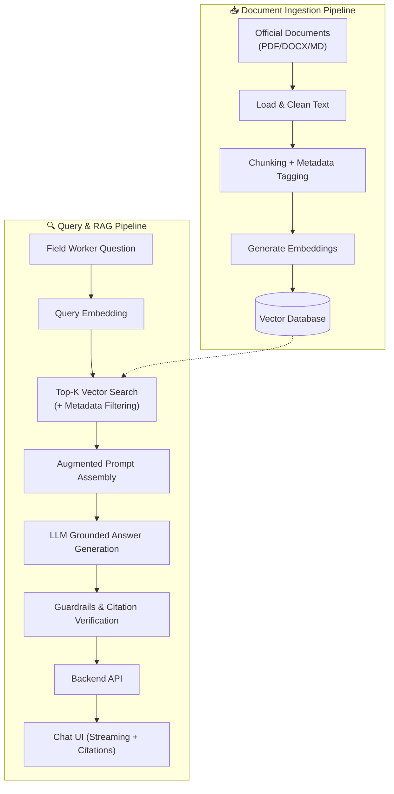

# 🛡️ FieldSure AI

> **RAG Assistant for Public Health Field Workers**  
> Answers outbreak, vaccination, and advisory questions using strictly the agency's latest published documents, with source citations on every answer and deterministic safe refusals when documents don't cover the query.

---

## 📌 Table of Contents

- [Overview](#-overview)
- [Workspace Layout](#-workspace-layout)
- [System Architecture & Pipeline](#-system-architecture--pipeline)
- [Setup & Installation](#-setup--installation)
- [Environment Configuration](#-environment-configuration)
- [Execution & Usage](#-execution--usage)
- [Sprint Roadmap & Team Ownership](#-sprint-roadmap--team-ownership)
- [Prompt Design & Logging](#-prompt-design--logging)
- [Safety & Responsible AI](#-safety--responsible-ai)
- [Clean Run Reproduction](#-clean-run-reproduction)

---

## 📖 Overview

**FieldSure** is a Python-based Retrieval-Augmented Generation (RAG) system managed with **[uv](https://docs.astral.sh/uv/)**. It empowers public health field workers with fast, reliable, and verified access to official health guidelines, protocols, and advisories.

### Key Highlights:
- **100% Grounded Answers**: Strict grounding prevents invented advice or hallucinations.
- **Source-Level Citations**: Every generated statement includes traceable references.
- **Safe Fallback & Refusals**: Explicit fallback mechanisms when domain documents lack relevant coverage.
- **Modern Tooling**: Dependency management and virtual environments managed via `uv`.

---

## 📂 Workspace Layout

```
SW_S66_FieldSure_AI_Kalvium-Community/
│
├── data/          # Input documents: guidelines, protocols, advisories (git-ignored)
├── src/           # Source code (ingestion, retrieval, RAG, backend)
├── prompts/       # Prompt templates (system and user roles)
├── outputs/       # Generated results & tracked sample execution logs
├── frontend/      # Chat UI (streaming answers, citation panel)
├── .env.example   # Template for environment variables
├── pyproject.toml # Project configuration & dependencies
├── uv.lock        # Locked dependency tree
└── Readme.md      # Project documentation
```

| Path | Purpose |
| :--- | :--- |
| `data/` | Input documents: guidelines, protocols, advisories *(git-ignored)* |
| `src/` | Source code (ingestion, retrieval, RAG, backend) |
| `prompts/` | Prompt templates (system and user roles) |
| `outputs/` | Generated results; sample logs are tracked |
| `frontend/` | Chat UI (streaming answers, citation panel) |

---

## 🔄 System Architecture & Pipeline



---

## ⚙️ Setup & Installation

FieldSure uses **`uv`** for dependency resolution and virtual environment management.

### 1. Clone & Sync Dependencies
```bash
# Sync dependencies and configure virtual environment
uv sync
```

---

## 🔑 Environment Configuration

Copy the template `.env.example` into `.env` and fill in your credentials (`.env` is git-ignored):

#### Windows (Command Prompt / PowerShell)
```powershell
copy .env.example .env
```

#### macOS / Linux
```bash
cp .env.example .env
```

### Required Configuration Keys

| Variable | Description |
| :--- | :--- |
| `API_BASE_URL` | Base URL for the LLM API provider |
| `API_KEY` | API Key for authentication |
| `CHAT_MODEL` | Target chat completion model name |
| `EMBEDDING_MODEL` | Embedding model used for indexing and vector search |
| `VECTOR_DB_URL` / `VECTOR_DB_PATH` | Vector database connection string or local storage path |

---

## 🚀 Execution & Usage

### Run Chat Completion Client
Execute the core chat completion script:
```bash
uv run python src/chat_completion.py
```

### Run Prompt Comparison
Compare output quality between baseline and constrained system prompts:
```bash
uv run python src/prompt_comparison.py
```

### Run the Embedding Fundamentals Demo
Generate embeddings for sample texts and compare their cosine similarity:
```bash
uv run python -m src.embedding_fundamentals
```

### Embed Prepared Corpus Chunks
Generate embeddings for the first three prepared chunks using `API_KEY`,
`API_BASE_URL`, and `EMBEDDING_MODEL` from `.env`. Each vector is saved with its
source text and metadata:
```bash
uv run python -m src.embed_corpus
```
Use `--input`, `--output`, and `--limit` to choose a JSONL corpus, output path,
and number of chunks. The default full-vector output is
`outputs/embedded_chunks.jsonl`.

### Rank Chunks by Embedding Similarity
After generating stored chunk vectors, embed a query and rank the chunks by
cosine similarity:
```bash
uv run python -m src.rank_chunks --query "How can field workers reduce dengue risk?"
```
The command reports the most and least similar chunks with their scores and
source metadata. See `outputs/embedding_similarity_sample.md` for a sample.

> **Note on Prompt Comparison**:  
> Sends identical field-worker questions across a vague system prompt versus a constrained, citation-enforced prompt. Prints responses and logs payloads, token usage, and metadata without exposing API keys. Configuration and API failures are handled cleanly without raw tracebacks and return non-zero exit codes.

---

## 👥 Sprint Roadmap & Team Ownership

| Stage | Owner | Modules | Execution Command |
| :--- | :--- | :--- | :--- |
| **Documents + LLM** | Member 1 | #1–#4, #10–#15 | `uv run python src/<script>.py` |
| **Embeddings + Retrieval** | Member 2 | #16–#18, #20–#25, #27 | `uv run python src/<script>.py` |
| **RAG + Backend + App** | Member 3 | #28–#32, #34–#38, #40 | `uv run python src/<script>.py` |

*(Replace `<script>` with the respective stage script name as modules are merged).*

<details>
<summary><strong>🔻 Expand Module Breakdown by Team Member</strong></summary>

### 👤 Member 1: Documents & LLM Foundation
- **#1, #2**: Dev environment, GitHub repo setup, and team workflow.
- **#3, #4**: LLM API access, first completion call, and prompt construction (system/user roles).
- **#10, #11**: Multi-format document loading, text extraction, and cleaning.
- **#12, #13, #14**: Chunking strategies, chunk metadata/source tracking, and token-aware size & overlap.
- **#15**: Corpus preparation and ingestion validation.

### 👤 Member 2: Embeddings, Vector DB & Retrieval
- **#16, #17, #18, #20**: Embedding fundamentals, generation via API, similarity metrics, and quality checks.
- **#21, #22**: Vector DB setup, indexing, and metadata storage.
- **#23, #24, #25**: Top-K similarity search, metadata filtering, hybrid search, and relevance tuning.
- **#27**: Retrieval evaluation and recall testing.

### 👤 Member 3: RAG, Backend & Application
- **#28, #29, #30**: RAG architecture, context injection, and grounded answer generation.
- **#31, #32**: Source citation, hallucination guardrails, and refusal handling.
- **#34**: RAG evaluation and answer quality scoring.
- **#35, #36**: Backend API, document upload, and indexing endpoints.
- **#37, #38**: Chat UI with streaming responses and citation display.
- **#40**: Deployment, documentation, and final delivery.

</details>

---

## 📝 Prompt Design & Logging

- **System Prompt**: Located in `prompts/`. Configured to restrict answers strictly to retrieved documents, mandate source citations for every claim, set concise answer bounds, and provide deterministic refusals for ungrounded queries.
- **Sample Outputs & Logs**: Execution logs are versioned under `outputs/`:
  - `outputs/chat_completion_sample.log`
  - `outputs/prompt_comparison_sample.log`
  - `outputs/embedding_fundamentals_sample.md`
  - `outputs/embedding_api_sample.md`
  - `outputs/embedding_similarity_sample.md`

---

## 🛡️ Safety & Responsible AI

- **Grounded Verification**: Answers derive strictly from verified retrieved context. Queries with weak or conflicting evidence trigger a safe refusal.
- **Guidance Versioning**: Superseded and withdrawn advisories are tagged; the latest active version is prioritized.
- **Non-Diagnostic Notice**: FieldSure is an informational retrieval tool for official protocols and not an autonomous diagnostic system.
- **Privacy & Security**: Zero collection or logging of patient/personal health information (PHI/PII). All secret keys remain isolated in `.env`.

---

## 🧹 Clean Run Reproduction

To reproduce the environment completely from scratch:

```bash
# 1. Remove existing virtual environment
rmdir /s /q .venv          # Windows
# rm -rf .venv             # macOS / Linux

# 2. Re-sync environment from uv.lock
uv sync

# 3. Configure secrets
copy .env.example .env     # Windows
# cp .env.example .env     # macOS / Linux
```
